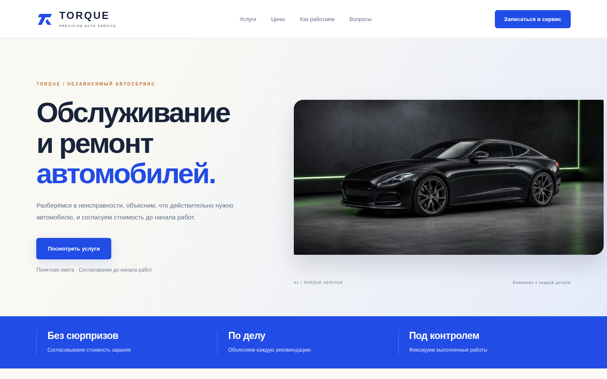
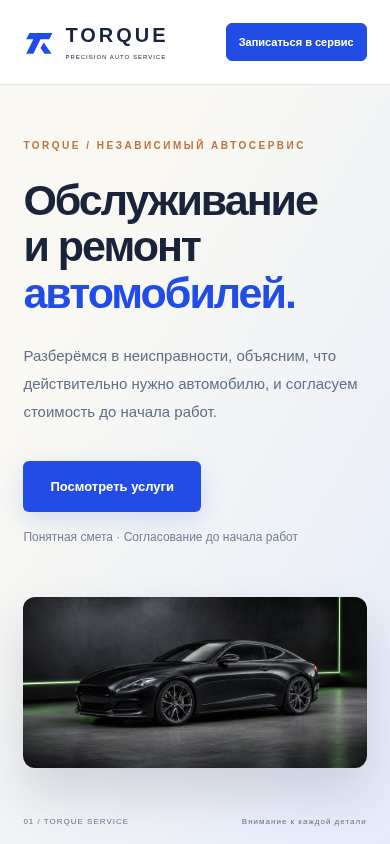

# TORQUE — сайт автосервиса

## Демо

**[Открыть сайт →](https://torque-autoservice.vercel.app)**

Демонстрационный проект для портфолио: адаптивный
лендинг автосервиса на Next.js и React.

🌐 **Посмотреть сайт:** https://torque-autoservice-ssrd.vercel.app

## О проекте

Концепт сайта с подробной презентацией услуг
и понятным сценарием обращения в автосервис.

В оформлении использованы светлый фон, насыщенный
синий цвет и медные акценты.

## Что реализовано

- 11 секций лендинга.
- Адаптивная версия для смартфонов и компьютеров.
- Карточки услуг с изображениями.
- Разделы технического обслуживания и диагностики.
- Демонстрационный прайс.
- Этапы работы и принципы согласования ремонта.
- Раскрывающийся FAQ.
- Демонстрационная форма с проверкой обязательных полей.

## Технологии

Next.js · React · JavaScript · CSS

## Запуск локально

Установите Node.js и выполните:

    npm install
    npm run dev

Откройте http://localhost:3000

## Сборка

    npm run build
    npm run start

## Статус проекта

Это учебный концепт, а не сайт действующего автосервиса.
Цены приведены для демонстрации.

Форма не отправляет и не сохраняет данные.
Серверная обработка заявок не подключена.

Изображения сгенерированы с помощью ИИ.
При разработке использовались ИИ-инструменты.

## Автор

Андрей — https://github.com/shalim-andrej
